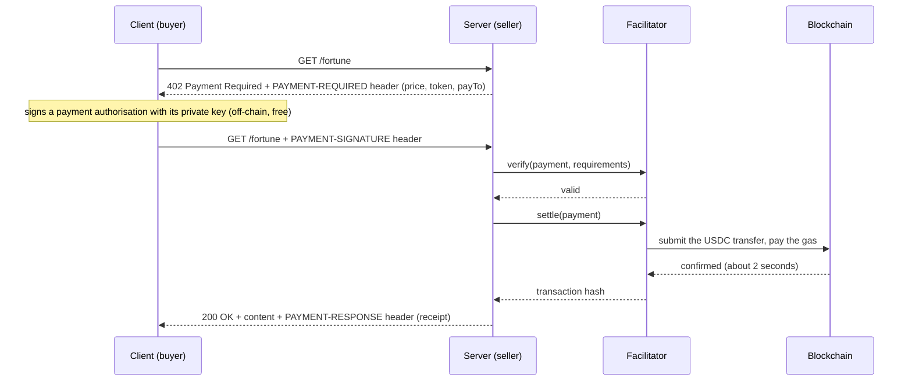

## Pay-per-request APIs with x402 and Stablecoins

> This repository was created for the "Pay-per-request APIs with x402 and Stablecoins" workshop in UCD
> (Blockchain & Decentralization module).

Hi there! :wave:

In this workshop we will build an HTTP API that answers `402 Payment Required` and only unlocks its
content after a small payment in testnet USDC. We will then write a client that pays automatically,
and finally we will pay for each other's APIs.

By the end of the workshop you will have a paid API running on a public URL, a client (and maybe an
agent) that buys from your classmates' APIs, and a block explorer full of transactions to prove it.

All you need is a browser and a GitHub account. No browser wallet, no API keys, nothing to install.

## Table of Contents

- [Pay-per-request APIs with x402 and Stablecoins](#pay-per-request-apis-with-x402-and-stablecoins)
- [Table of Contents](#table-of-contents)
- [Concepts](#concepts)
  - [HTTP 402 Payment Required](#http-402-payment-required)
  - [The x402 flow](#the-x402-flow)
  - [What a facilitator does](#what-a-facilitator-does)
  - [Why stablecoins suit machine payments](#why-stablecoins-suit-machine-payments)
  - [Why Base Sepolia](#why-base-sepolia)
- [Getting Started](#getting-started)
  - [Prerequisites](#prerequisites)
  - [Open the Codespace](#open-the-codespace)
- [Part 0: Your wallet](#part-0-your-wallet)
- [Part 1: A paid API](#part-1-a-paid-api)
- [Part 2: A client that pays](#part-2-a-client-that-pays)
- [Part 3: Pay your classmates](#part-3-pay-your-classmates)
- [Part 4: Stretch goals](#part-4-stretch-goals)
- [Challenges](#challenges)
- [How to](#how-to)
- [Troubleshooting](#troubleshooting)
- [Resources](#resources)
- [License](#license)
- [Acknowledgements](#acknowledgements)

## Concepts

### HTTP 402 Payment Required

HTTP has had a status code for payments since 1997: `402 Payment Required`. The specification
reserved it "for future use", and for almost thirty years nobody agreed on what a client should
actually do when it received one. Paying on the web ended up happening around HTTP instead of
inside it: accounts, API keys, credit cards, monthly plans.

[x402](https://docs.x402.org) is an open protocol that finally gives `402` a meaning. The server
says what it wants in a response header, the client pays and retries the same request with proof
of payment in a request header. No account, no API key, no sign-up form. That makes it usable by
programs, not just people.

### The x402 flow



### What a facilitator does

The facilitator is a helper service that the **server** talks to. It does two jobs:

1. **Verify**: check that the client's signed authorisation is valid, for the right amount, to the
   right address, and that the client actually has the funds.
2. **Settle**: submit the transfer to the blockchain and wait for it to be confirmed.

The client never sends a transaction itself. It signs an
[EIP-3009](https://eips.ethereum.org/EIPS/eip-3009) `transferWithAuthorization` message: "I allow
exactly 0.001 USDC to move from my address to this address, valid for the next 5 minutes". The
facilitator can submit that message, and it pays the gas to do so, but it cannot change the amount
or the recipient. So the facilitator is trusted for liveness (it could refuse to settle), but not
with your money. Anyone can run one, and in [Challenge 12](#challenges) you will.

### Why stablecoins suit machine payments

- **Stable unit of account**: a price of $0.001 stays $0.001. A volatile token would make pricing
  an API a guessing game.
- **Tiny amounts**: USDC has 6 decimals, so one thousandth of a dollar is just `1000` base units.
  Card payments have fixed fees that make anything under a few cents uneconomic.
- **Fast, final settlement**: a couple of seconds, and no chargebacks.
- **No accounts**: a program only needs a key pair to pay. It doesn't need a bank account, a credit
  card or a signed contract with every API it uses.
- **Programmable**: payments are just signed messages, so a script or an agent can decide when to pay
  and how much.

There are trade-offs too, and they are worth discussing: every payment is public on the ledger,
losing a key means losing the funds, and the stablecoin issuer can freeze addresses.

### Why Base Sepolia

We use **Base Sepolia**, a public Ethereum layer-2 testnet (network id `eip155:84532`). The
reference x402 facilitator supports it, Circle's testnet USDC on it supports EIP-3009, blocks come
every 2 seconds, and it has a public block explorer. Testnet tokens have no value, so nothing you
do today can cost you real money.

## Getting Started

### Prerequisites

- A laptop with an internet connection and a browser
- A [GitHub](https://github.com) account

That's it. Everything else runs in a GitHub Codespace, a Linux machine in the cloud with Node.js
and all the dependencies already installed. Personal GitHub accounts include free Codespaces hours,
far more than this workshop needs.

> :information_source: Prefer your own machine? You need [Node.js](https://nodejs.org) 22 or newer.
> Clone this repository, run `npm ci`, and follow the same steps. Your API will only be reachable
> on `localhost`, so for Part 3 you will need a tunnel of your choice, or a Codespace.

### Open the Codespace

1. Open this repository on GitHub.
2. Click **Code** > **Codespaces** > **Create codespace on main**.
3. Wait a minute or two. When the editor appears, the dependencies are installed.
4. Open a terminal: **Terminal** > **New Terminal** (or <kbd>Ctrl</kbd> + <kbd>`</kbd>).

Every command below runs in that terminal.

## Part 0: Your wallet

Create a wallet. This generates a private key, saves it to `.env` and prints your address:

```bash
npm run wallet
```

> :warning: This key is for the testnet only. `.env` is ignored by git, so it won't be committed.
> Never put a real key in it.

Register with the class board, using the board URL from the slides:

```bash
npm run register -- https://<board-url>
```

This sends your name, address and API URL to the board, and saves the class settings to your `.env`.
The instructor will then send testnet USDC to every registered address. Wait a minute and check:

```bash
npm run balance
```

If you see a USDC balance, you are ready to go! Open the explorer link it prints and look at the
transfer you received.

## Part 1: A paid API

Start the API:

```bash
npm run server
```

It restarts by itself every time you save a file. Open a **second terminal** (the **+** button in
the terminal panel) and call it:

```bash
curl -i localhost:4021/hello
curl -i localhost:4021/fortune
```

Both are free for now. Open [`starter/server.js`](starter/server.js): your job is to put a price on
`/fortune`.

**TODO 1.1**: describe the paid route in `paidRoutes`. Each key is `"METHOD /path"`, and each value
says which payment scheme, price, network and recipient the route accepts.

**TODO 1.2**: create the facilitator client and the resource server, and add the payment middleware.

<details>
<summary>Hint</summary>

The [seller quickstart](https://docs.x402.org/getting-started/quickstart-for-sellers) shows the
three pieces you need: `HTTPFacilitatorClient`, `x402ResourceServer` (with `.register(...)`) and
`paymentMiddleware`. They are already imported at the top of the file. Use the constants
`FACILITATOR_URL`, `NETWORK` and `payTo` instead of the hard-coded values in the docs.

</details>

Save the file and call the endpoint again:

```bash
curl -i localhost:4021/fortune
```

You should get `402 Payment Required` and a `PAYMENT-REQUIRED` header. It is base64-encoded JSON,
so decode it to see what your server is asking for:

```bash
curl -s -D - -o /dev/null localhost:4021/fortune | grep -i payment-required | cut -d' ' -f2 | base64 -d
```

Look at `amount`: `"$0.001"` became `1000`, because USDC has 6 decimals. `asset` is the USDC
contract, and `payTo` is your own address.

> :information_source: `curl localhost:4021/` (the free index) lists your paid endpoints and their
> prices. Classmates and agents use it to discover what you sell.

## Part 2: A client that pays

Run the client against your own API:

```bash
npm run client
```

As it is, the client uses plain `fetch`, so it just prints the `402` and the decoded payment
requirements. Open [`starter/client.js`](starter/client.js) and make it pay.

**TODO 2.1**: create an `x402Client` and register an `ExactEvmScheme` that signs with `account()`.

**TODO 2.2**: wrap `fetch` with `wrapFetchWithPayment` and use the wrapped version.

**TODO 2.3**: decode the `PAYMENT-RESPONSE` header and print a block explorer link to the transaction.

<details>
<summary>Hint</summary>

The [buyer quickstart](https://docs.x402.org/getting-started/quickstart-for-buyers) has all three
steps. `decodePaymentResponseHeader(header)` returns an object with a `transaction` field.

</details>

Run it again. You should see `200 OK`, a fortune, and a transaction link. Open the link and look
closely:

- **Who sent the transaction** (`From`)? It is not you. It's the facilitator, which paid the gas.
- **Who moved the tokens** (the ERC-20 transfer)? From your address to the `payTo` address.
- You paid yourself, so your balance did not change. In Part 3 it will.

Run `npm run balance` before and after a payment to a classmate to see the difference.

## Part 3: Pay your classmates

Open the class board in your browser (the URL you registered with). It shows every API, whether it
is up, and how many paid requests each one has received. The same data is available as JSON at
`<board-url>/apis.json`.

Pick a classmate whose API is up and buy their fortune:

```bash
npm run client -- https://<their-codespace>-4021.app.github.dev/fortune
```

Then make your API worth paying for. **TODO 3.1** in `starter/server.js`: replace the fortunes with
something of your own. Jokes, haiku, ASCII art, a random Pokémon, a weather report for Dublin, a
fake stock tip. Make it unique and watch your counter on the board go up.

> :information_source: Your API must be **public** for classmates to reach it. The Codespace sets
> this up for you. If the board says "port is private", see [Troubleshooting](#troubleshooting).

## Part 4: Stretch goals

Pick whatever interests you. There are no TODOs here, only ideas:

- **Per-route prices**: add a `/premium` route that costs ten times more.
- **Dynamic pricing**: `price` can be a function of the request, for example
  `(ctx) => ...ctx.adapter.getQueryParam("count")...`.
- **A spending cap**: stop the client from spending more than a budget. Look at
  `client.onBeforePaymentCreation(...)`, which can return `{ abort: true, reason }`.
- **An agent**: [`starter/agent.js`](starter/agent.js) reads the board, discovers what every API
  sells, and decides what to buy with plain rules. No LLM needed. Run it with `npm run agent`.

The [challenges](#challenges) below go further.

## Challenges

Ordered from very simple to hard. Do them in any order you like.

| # | Level | Challenge |
|---|---|---|
| 1 | Easy | Change the price of `/fortune` and confirm the new `amount` in the 402 header. |
| 2 | Easy | Find one of your payments on the explorer. Identify the payer, the payee and who paid the gas. |
| 3 | Easy | Pay three different classmates. Check that your USDC balance went down by the right amount. |
| 4 | Easy | Add a free `/stats` endpoint that returns how many fortunes your API has sold. |
| 5 | Medium | Add a second paid route with a different price, and list both in `GET /`. |
| 6 | Medium | Make the client print your USDC balance before and after each payment. |
| 7 | Medium | Add a per-run budget to the client: refuse to sign once it has spent `BUDGET` USDC. |
| 8 | Medium | Dynamic pricing: `/bulk?count=N` returns N fortunes at $0.001 each. |
| 9 | Hard | Surge pricing: make the price depend on how busy your API is. Hint: the price is computed again when the paid retry arrives, and it must match what the client signed. How do you keep it stable? |
| 10 | Hard | Write an agent that buys the cheapest offer from every API on the board, without paying anyone twice, until its budget runs out. |
| 11 | Hard | Accept **EURC** as well as USDC on the same route (`accepts` can be an array). The client has to allow the extra asset too. |
| 12 | Expert | Run your own facilitator (see [`instructor/facilitator.js`](instructor/facilitator.js)) and point your server at it. What could a dishonest facilitator do, and what could it not do? |
| 13 | Expert | A reseller: your API buys from a classmate's API, adds something, and resells it at a markup. You are now a business in a machine-to-machine economy. |
| 14 | Expert | Audit yourself: write a script that reads `Transfer` events from the chain and checks that every fortune your server served was really paid for. |

## How to

### Use AI tools

You are welcome to use AI coding assistants during the workshop. They are good at x402 boilerplate,
but they often suggest the older v1 packages (`x402-express`, `x402-fetch`). This repository uses
the v2 packages under the `@x402/*` scope. Point your assistant at the
[x402 docs](https://docs.x402.org) and at the code in this repository.

### Check the balance of any address

```bash
npm run balance -- 0xSomeAddress
```

### Run your API on a different port

```bash
PORT=4030 npm run server
```

### Run the reference solution

The instructor will publish the reference solution during the workshop. Get it with:

```bash
git pull
```

Then run it next to your own code. It reads the same `.env`:

```bash
node --env-file=.env completed/server.js
node --env-file=.env completed/client.js
BUDGET=0.01 node --env-file=.env completed/agent.js
```

### Run the instructor tools

See [`instructor/README.md`](instructor/README.md) for funding, the class board, the facilitator and
the load test.

## Troubleshooting

| Problem | Fix |
|---|---|
| `No PRIVATE_KEY in .env` | Run `npm run wallet`. Make sure you are in the repository folder. |
| `Cannot find module` or `ERR_MODULE_NOT_FOUND` | The dependencies did not finish installing. Run `npm ci`. |
| `EADDRINUSE: address already in use` | Your server is already running in another terminal. Stop it with <kbd>Ctrl</kbd> + <kbd>C</kbd>, or use another `PORT`. |
| The board says **port is private** | Open the **Ports** tab, right-click port 4021, then **Port Visibility** > **Public**. |
| The board says **unreachable** | Your server is not running, or your Codespace stopped. Restart it with `npm run server`. |
| 402 again after paying, `insufficient_funds` | You are out of USDC. Run `npm run balance` and ask the instructor for a top-up. |
| 402 again after paying, `invalid_exact_evm_transaction_failed` | Settlement failed on the facilitator side. Nothing was charged. Try again in a few seconds. |
| Client error `rejected by spendControls.maxAmountPerPayment` | By default the client refuses to pay more than $1 per request. That's a safety feature. |
| Client says `budget ... reached` | Your own spending cap worked. Raise `BUDGET` or start a new run. |
| Your Codespace stopped while you were away | Codespaces stop after 30 idle minutes. Reopen it from GitHub and run `npm run server` again. The URL stays the same. |

## Resources

1. x402 documentation: https://docs.x402.org
2. x402 source code and examples: https://github.com/x402-foundation/x402
3. HTTP 402 in the HTTP semantics specification (RFC 9110): https://www.rfc-editor.org/rfc/rfc9110#name-402-payment-required
4. EIP-3009, Transfer With Authorization: https://eips.ethereum.org/EIPS/eip-3009
5. viem documentation: https://viem.sh
6. Base Sepolia block explorer: https://sepolia.basescan.org
7. Circle testnet faucet (USDC and EURC): https://faucet.circle.com
8. GitHub Codespaces documentation: https://docs.github.com/en/codespaces
9. Express documentation: https://expressjs.com

## License

This project is licensed under [MIT License](LICENSE.md).

## Acknowledgements

Special thanks to the following contributors :heart:
- [@kgapos](https://github.com/kgapos)

and the following projects:
- [x402](https://github.com/x402-foundation/x402)
- [viem](https://github.com/wevm/viem)
- [Express](https://github.com/expressjs/express)
